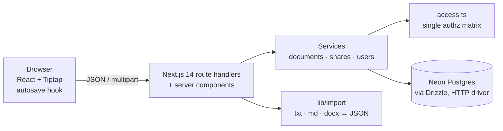

# Architecture note

Full design docs are in [`docs/`](docs/): PRD, HLD, LLD and UI/UX. This page is the short version: **what I prioritized and why**.

## Shape

One Next.js app on Vercel, one Neon database, no other services. Reviewers pay nothing and install nothing.

**Layering rule:** pages and route handlers → services → database. Handlers never touch SQL, and services never read cookies. Every document read or write passes through `assertCan(user, doc, capability)` in [`src/lib/access.ts`](src/lib/access.ts), so authorization lives in one auditable, tested place.

## Data model

`users`, `documents(owner_id, title, content jsonb, content_text, version)`, `document_shares(document_id, user_id, role viewer|editor)` with the primary key on (document, user), so sharing again is an upsert. Shares are removed automatically when their document is deleted.

## What I prioritized, and why

1. **Never lose a user's words.** Autosave saves about 1s after typing stops. It keeps a single request in flight, retries with backoff when offline, warns before leaving with unsaved changes, and flushes when you navigate away. A `version` column provides optimistic concurrency, so two people editing the same doc can't silently overwrite each other: the stale save gets a 409 and a clear "Reload latest / Copy my text" banner. I judged this the most important property of a docs product, and the honest substitute for real-time collaboration within the timebox.
2. **Access control that is actually enforced.** Roles are owner, editor and viewer. They are checked on the server for every request, not just hidden in the UI. Outsiders get 404 rather than 403, so the app doesn't reveal that a document exists. Integration tests cover the whole matrix.
3. **Formatting fidelity.** Content is stored as Tiptap/ProseMirror JSON, not HTML, so documents round-trip exactly and there is no stored-HTML XSS surface. Imports convert to the **same schema** as the editor, so anything the editor can't show (scripts, iframes, images) is dropped by construction.
4. **Zero-friction review.** Seeded demo users with mocked auth (a signed httpOnly JWT cookie) let a reviewer test sharing in seconds. The session module is the single place to swap in real auth.

## Key decisions

| Decision | Alternatives | Why |
|---|---|---|
| Next.js monolith (UI + REST route handlers) | Separate API service | One deploy and one URL. The layering keeps it full-stack in structure. |
| Route handlers rather than Server Actions for mutations | Server Actions | Explicit HTTP status codes (401/403/404/409/413/415) that are easy to test and document. |
| Tiptap | Lexical, Slate, Quill | Mature, headless, and StarterKit covers every required format. |
| Neon HTTP driver | `pg` pool | Fits serverless (no connection exhaustion). Every write is a single statement, so no interactive transactions are needed. |
| Optimistic locking | Last-write-wins; CRDT (Yjs) | Prevents data loss at a tiny fraction of real-time collaboration's cost. |
| Import parsed in memory | Store originals in blob storage | The product value is the editable doc, and there's no paid or extra service. |
| PGlite for integration tests | Mocks; a shared test DB | Real Postgres semantics (joins, upserts, conditional updates) with the production migrations, offline and in about 1s. |

## Problems found in testing and fixed

- **Next 14 caches `fetch` by default.** The Neon driver queries over `fetch`, so reads went stale. Fixed with `cache: "no-store"` on the driver.
- **Next 14's client router cache** showed old titles after a rename. Fixed with `staleTimes.dynamic = 0`, plus a refresh when the dashboard is restored from browser history.
- **Stale sessions after a database re-seed** (user ids changed). Fixed: the session is resolved against the database on every request.
- **Intermittent Neon connect timeouts** on one network. Fixed with a retry, but **only** for connect-phase errors (the request never reached Neon), so a write can't be applied twice. This is tested.

## Deliberate cuts

Real-time co-editing and cursors, comments, version history, real auth, images and tables, folders and search, public links. Each is reasonable later; none was worth risking the core loop in a 4–6 hour box. What I'd build next is listed in [SUBMISSION.md](SUBMISSION.md).
