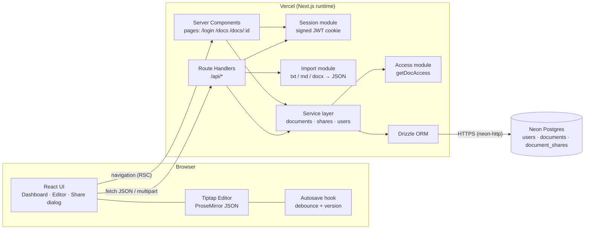
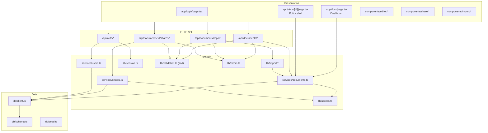
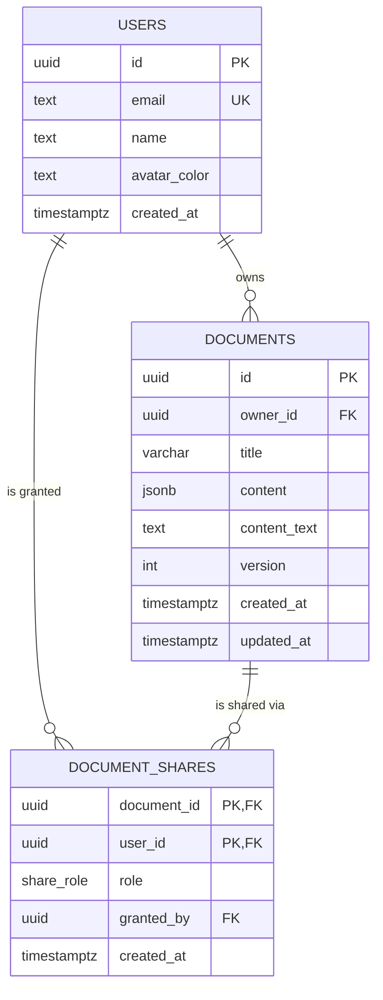
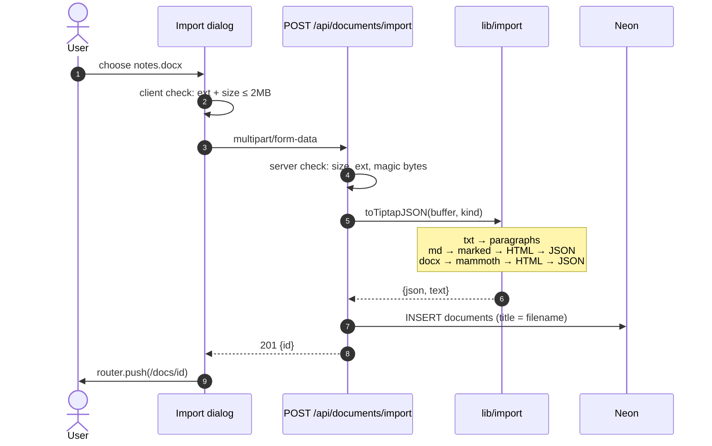
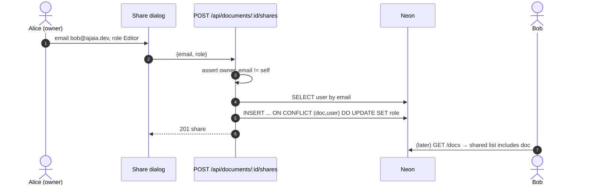
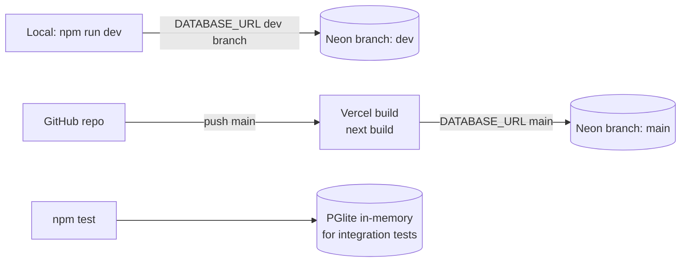

# HLD — High-Level Design

## 1. Architecture at a glance

A single **Next.js 14 App Router** application deployed on **Vercel**, talking to **Neon Postgres** through **Drizzle ORM** over Neon's serverless HTTP driver. No separate backend service, no blob store, no websocket server — every moving part is free-tier and zero-config for reviewers.



## 2. Key architectural decisions

| # | Decision | Alternatives considered | Rationale |
|---|---|---|---|
| D1 | **Next.js App Router monolith** (UI + API in one deploy) | Separate Express/Nest API | One repo, one deploy, one URL. Full-stack still demonstrated via explicit service/access layers. |
| D2 | **Tiptap (ProseMirror)** editor | Lexical, Slate, Quill, raw `contenteditable` | Headless, mature, StarterKit covers every required format; JSON doc model is schema-validated. |
| D3 | **Store content as Tiptap JSON (`jsonb`)** + derived `content_text` | Store HTML / Markdown | JSON is lossless for the editor schema, safe (no raw HTML injection on render), and queryable. `content_text` powers list previews and future search. |
| D4 | **Mocked auth: pick seeded user → signed httpOnly JWT cookie** (`jose`) | NextAuth, Clerk, Supabase Auth | Zero friction for reviewers, no third-party signup. `getSession()` is the single seam to swap in real auth. |
| D5 | **Authorization in one module (`lib/access.ts`)** used by every read/write | Checks sprinkled in handlers; Postgres RLS | One auditable function, unit-testable. RLS is overkill with a single DB role. |
| D6 | **Optimistic concurrency via `version` int** | Last-write-wins; CRDT/Yjs | Cheap, prevents silent data loss when two people edit — honest substitute for real-time collab. |
| D7 | **Import = parse in memory → new doc** (no file storage) | Store originals in S3/Vercel Blob | No paid/extra service; the product value is the editable doc, not the original file. |
| D8 | **Neon HTTP driver** (`drizzle-orm/neon-http`) | `pg` Pool, neon websockets | Best fit for serverless functions (no connection exhaustion, no cold pool). All writes are single statements, so no interactive transactions are needed. |
| D9 | **Route Handlers (REST) over Server Actions** for mutations | Server Actions | Explicit HTTP contract is easier to test, document, and reason about for status codes (401/403/404/409/413/415). |
| D10 | **Roles: `viewer` / `editor`** on shares | Single "has access" flag | Small cost, demonstrates real access logic; covers stretch item. |

## 3. Logical components



**Layering rule:** pages/handlers → services → db. Handlers never call Drizzle directly; services never read cookies. This keeps authz testable with plain function calls.

## 4. Data model (conceptual)



## 5. Access model

| Action | Owner | Editor | Viewer | No access |
|---|:-:|:-:|:-:|:-:|
| See in list | ✅ My documents | ✅ Shared with me | ✅ Shared with me | — |
| Open / read | ✅ | ✅ | ✅ | 404 |
| Edit content | ✅ | ✅ | 403 | 404 |
| Rename | ✅ | ✅ | 403 | 404 |
| Manage shares | ✅ | 403 | 403 | 404 |
| Delete | ✅ | 403 | 403 | 404 |

404 (not 403) for no-access avoids confirming a document exists.

## 6. Key flows

### 6.1 Edit & autosave (with conflict protection)

```mermaid
sequenceDiagram
    autonumber
    actor U as User
    participant E as Tiptap + useAutosave
    participant API as PATCH /api/documents/:id
    participant ACL as access.ts
    participant DB as Neon

    U->>E: types
    E->>E: status = "Unsaved"; debounce 1000ms
    E->>API: {content, version: 7}
    API->>ACL: getDocAccess(user, id)
    ACL->>DB: SELECT doc + share
    ACL-->>API: role = owner|editor
    API->>DB: UPDATE ... SET version=8 WHERE id=? AND version=7 RETURNING
    alt row updated
        DB-->>API: {version: 8, updatedAt}
        API-->>E: 200 {version: 8}
        E-->>U: "Saved"
    else 0 rows (stale)
        API-->>E: 409 CONFLICT
        E-->>U: Banner "Updated elsewhere — Reload"
    end
```

### 6.2 Import file → new document



### 6.3 Share



## 7. Deployment & environments



- **Env vars:** `DATABASE_URL` (Neon pooled connection string), `SESSION_SECRET` (≥32 chars).
- **Migrations:** `drizzle-kit generate` → committed SQL in `drizzle/`; `drizzle-kit migrate` run locally against prod before deploy (documented), seed via `npm run db:seed`.
- **Neon branching** gives an isolated dev DB for free.

## 8. Cross-cutting concerns

| Concern | Approach |
|---|---|
| Validation | Zod schemas shared by client + server (`lib/validation.ts`). |
| Errors | `AppError(code, status, message)` → handler wrapper maps to JSON `{error:{code,message}}`; client maps codes to toasts. |
| Security | httpOnly + SameSite=Lax + Secure cookie; authz per request (not relying on middleware alone); no raw HTML rendering — content rendered by Tiptap from schema-validated JSON; import HTML passes through Tiptap schema which drops unknown tags/attrs (scripts, styles, iframes). |
| Observability | Structured `console.error` in handler wrapper (visible in Vercel logs). |
| Testing | Vitest unit (access matrix, import parsers, validation) + integration (services against PGlite with real migrations). Optional Playwright smoke. |

## 9. Scalability path (documented, not built)

- Real-time: add Yjs + Hocuspocus/Liveblocks; `content` becomes a Yjs snapshot.
- Large docs: move to delta saves / Yjs updates instead of full-doc PATCH.
- Search: Postgres `tsvector` on `content_text` + GIN index.
- Files: Vercel Blob/S3 for attachments with signed URLs.
- Auth: replace `lib/session.ts` internals with Auth.js / Clerk; rest of the app unchanged.
