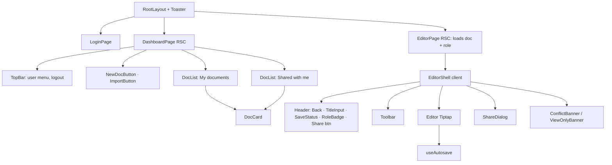
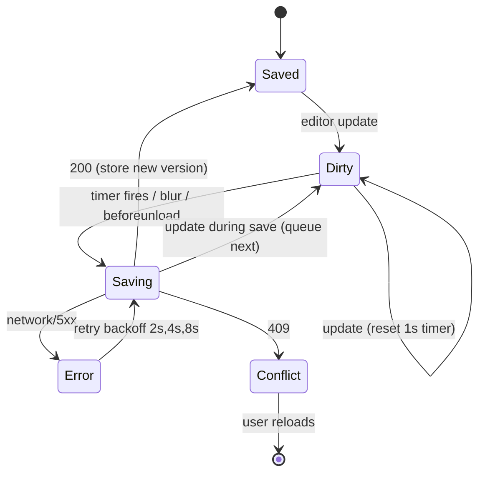
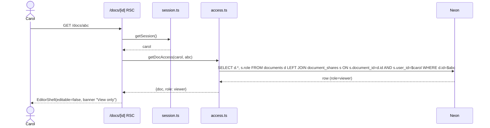

# LLD — Low-Level Design

## 1. Tech stack & packages

| Concern | Choice |
|---|---|
| Framework | `next@14.2.35` (App Router, TS, `src/` dir), `react@18.3`, `react-dom@18.3` |
| Styling | `tailwindcss`, `lucide-react` icons, `sonner` toasts, `clsx` + `tailwind-merge` |
| Editor | `@tiptap/react`, `@tiptap/pm`, `@tiptap/starter-kit` (v3 includes Underline, Link), `@tiptap/extension-placeholder` |
| ORM / DB | `drizzle-orm`, `@neondatabase/serverless`, dev: `drizzle-kit` |
| Auth | `jose` (HS256 JWT in cookie) |
| Validation | `zod` |
| Import | `mammoth` (docx → HTML), `marked` (md → HTML), `@tiptap/html` (HTML → JSON, server-safe) |
| Tests | `vitest`, `@electric-sql/pglite` (in-memory Postgres for integration), optional `@playwright/test` |
| Tooling | `tsx` (seed script), `dotenv` |

```bash
npx create-next-app@14 ajaia-docs --ts --tailwind --eslint --app --src-dir --import-alias "@/*"
npm i drizzle-orm @neondatabase/serverless zod jose @tiptap/react @tiptap/pm @tiptap/starter-kit @tiptap/extension-placeholder @tiptap/html mammoth marked sonner lucide-react clsx tailwind-merge
npm i -D drizzle-kit vitest @electric-sql/pglite tsx dotenv
```

## 2. Folder structure

```
ajaia-docs/
├─ drizzle/                       # generated SQL migrations (committed)
├─ drizzle.config.ts
├─ src/
│  ├─ app/
│  │  ├─ layout.tsx               # <Toaster/>, fonts
│  │  ├─ page.tsx                 # redirect → /docs or /login
│  │  ├─ login/page.tsx           # seeded user picker
│  │  ├─ docs/
│  │  │  ├─ page.tsx              # Dashboard (RSC): owned + shared
│  │  │  └─ [id]/page.tsx         # Editor shell (RSC loads doc + role)
│  │  └─ api/
│  │     ├─ auth/login/route.ts   # POST
│  │     ├─ auth/logout/route.ts  # POST
│  │     ├─ users/route.ts        # GET (list for share picker)
│  │     └─ documents/
│  │        ├─ route.ts           # GET list, POST create
│  │        ├─ import/route.ts    # POST multipart
│  │        └─ [id]/
│  │           ├─ route.ts        # GET, PATCH, DELETE
│  │           └─ shares/
│  │              ├─ route.ts     # GET, POST
│  │              └─ [userId]/route.ts  # DELETE
│  ├─ components/
│  │  ├─ editor/Editor.tsx        # client: Tiptap instance
│  │  ├─ editor/Toolbar.tsx
│  │  ├─ editor/TitleInput.tsx
│  │  ├─ editor/SaveStatus.tsx
│  │  ├─ editor/useAutosave.ts
│  │  ├─ share/ShareDialog.tsx
│  │  ├─ import/ImportButton.tsx
│  │  ├─ docs/DocCard.tsx · DocList.tsx · NewDocButton.tsx
│  │  └─ ui/ (Button, Dialog, Badge, Avatar, Skeleton)
│  ├─ db/
│  │  ├─ schema.ts
│  │  ├─ client.ts
│  │  └─ seed.ts
│  ├─ lib/
│  │  ├─ session.ts               # getSession / requireUser / set/clear cookie
│  │  ├─ access.ts                # getDocAccess, can()
│  │  ├─ errors.ts                # AppError + handler wrapper
│  │  ├─ validation.ts            # zod schemas
│  │  └─ import/
│  │     ├─ index.ts              # detectKind + toDocument
│  │     ├─ txt.ts · md.ts · docx.ts
│  │     └─ extensions.ts         # shared Tiptap extension list (server+client)
│  └─ services/
│     ├─ documents.ts
│     ├─ shares.ts
│     └─ users.ts
├─ tests/
│  ├─ access.test.ts
│  ├─ import.test.ts
│  ├─ documents.service.test.ts   # PGlite integration
│  └─ fixtures/ sample.md · sample.docx · sample.txt
└─ README.md · ARCHITECTURE.md · AI_WORKFLOW.md · SUBMISSION.md
```

## 3. Database schema (Drizzle)

`src/db/schema.ts`

```ts
import { pgTable, uuid, text, varchar, jsonb, integer, timestamp, pgEnum, primaryKey, index } from "drizzle-orm/pg-core";

export const shareRole = pgEnum("share_role", ["viewer", "editor"]);

export const users = pgTable("users", {
  id: uuid("id").primaryKey().defaultRandom(),
  email: text("email").notNull().unique(),
  name: text("name").notNull(),
  avatarColor: text("avatar_color").notNull().default("#6366f1"),
  createdAt: timestamp("created_at", { withTimezone: true }).notNull().defaultNow(),
});

export const documents = pgTable("documents", {
  id: uuid("id").primaryKey().defaultRandom(),
  ownerId: uuid("owner_id").notNull().references(() => users.id, { onDelete: "cascade" }),
  title: varchar("title", { length: 200 }).notNull().default("Untitled document"),
  content: jsonb("content").$type<TiptapDoc>().notNull().default({ type: "doc", content: [{ type: "paragraph" }] }),
  contentText: text("content_text").notNull().default(""),
  version: integer("version").notNull().default(1),
  createdAt: timestamp("created_at", { withTimezone: true }).notNull().defaultNow(),
  updatedAt: timestamp("updated_at", { withTimezone: true }).notNull().defaultNow(),
}, (t) => [
  index("documents_owner_updated_idx").on(t.ownerId, t.updatedAt),
]);

export const documentShares = pgTable("document_shares", {
  documentId: uuid("document_id").notNull().references(() => documents.id, { onDelete: "cascade" }),
  userId: uuid("user_id").notNull().references(() => users.id, { onDelete: "cascade" }),
  role: shareRole("role").notNull().default("viewer"),
  grantedBy: uuid("granted_by").notNull().references(() => users.id),
  createdAt: timestamp("created_at", { withTimezone: true }).notNull().defaultNow(),
}, (t) => [
  primaryKey({ columns: [t.documentId, t.userId] }),
  index("document_shares_user_idx").on(t.userId),
]);

export type TiptapDoc = { type: "doc"; content?: unknown[] };
export type ShareRole = (typeof shareRole.enumValues)[number];
export type AccessRole = "owner" | ShareRole;
```

`src/db/client.ts`

```ts
import { neon } from "@neondatabase/serverless";
import { drizzle } from "drizzle-orm/neon-http";
import * as schema from "./schema";

export const db = drizzle(neon(process.env.DATABASE_URL!), { schema });
export type DB = typeof db;
```

> Services accept a `db` parameter defaulting to this client, so integration tests inject a PGlite-backed Drizzle instance (`drizzle-orm/pglite`) running the same migrations.

`drizzle.config.ts`

```ts
import "dotenv/config";
import { defineConfig } from "drizzle-kit";
export default defineConfig({
  schema: "./src/db/schema.ts",
  out: "./drizzle",
  dialect: "postgresql",
  dbCredentials: { url: process.env.DATABASE_URL! },
});
```

`package.json` scripts

```json
{
  "dev": "next dev",
  "build": "next build",
  "start": "next start",
  "db:generate": "drizzle-kit generate",
  "db:migrate": "drizzle-kit migrate",
  "db:seed": "tsx src/db/seed.ts",
  "db:reset": "tsx src/db/seed.ts --reset",
  "test": "vitest run",
  "lint": "next lint"
}
```

**Seed** (`seed.ts`): upsert Alice/Bob/Carol; create 3 docs for Alice ("Welcome to Ajaia Docs" with every format, "Q4 Planning", "Private notes"); share "Q4 Planning" → Bob (editor) + Carol (viewer); 1 doc owned by Bob shared → Alice (viewer) so Alice's "Shared with me" is non-empty. Idempotent (`onConflictDoNothing`).

## 4. Module design

### 4.1 `lib/session.ts`

```ts
const COOKIE = "ajaia_session";
// payload: { sub: userId, email, name }   exp: 7d   alg: HS256(SESSION_SECRET)

export async function createSession(user: User): Promise<void>     // sets httpOnly, Secure (prod), SameSite=Lax, path=/
export async function clearSession(): Promise<void>
export async function getSession(): Promise<SessionUser | null>   // verifies JWT; null on invalid/expired
export async function requireUser(): Promise<SessionUser>        // throws AppError(UNAUTHORIZED, 401)
```

Pages call `getSession()` and `redirect("/login")` when null. `middleware.ts` (Next 14.2.35, patched for CVE-2025-29927) is **only** a UX redirect; every handler re-checks via `requireUser()`.

### 4.2 `lib/access.ts` (the single source of authz truth)

```ts
export type Capability = "read" | "edit" | "rename" | "share" | "delete";

const MATRIX: Record<AccessRole, Capability[]> = {
  owner:  ["read", "edit", "rename", "share", "delete"],
  editor: ["read", "edit", "rename"],
  viewer: ["read"],
};

export function can(role: AccessRole | null, cap: Capability): boolean {
  return role !== null && MATRIX[role].includes(cap);
}

/** One query: doc LEFT JOIN share for this user. */
export async function getDocAccess(db: DB, userId: string, docId: string)
  : Promise<{ doc: Document; role: AccessRole } | null>

/** Throws 404 if no access at all, 403 if access but lacks capability. */
export async function assertCan(db: DB, userId: string, docId: string, cap: Capability)
  : Promise<{ doc: Document; role: AccessRole }>
```

### 4.3 `services/documents.ts`

| Function | Behavior |
|---|---|
| `listForUser(userId)` | Returns `{ owned: DocSummary[], shared: (DocSummary & {role, owner:{name,email}})[] }`, each ordered by `updated_at desc`. Summary = id, title, updatedAt, preview (first 140 chars of `content_text`). |
| `create(userId, {title?, content?, contentText?})` | Insert, return doc. |
| `get(userId, id)` | `assertCan(read)` → `{doc, role}`. |
| `update(userId, id, {title?, content?, version})` | `assertCan(content ? "edit" : "rename")`; conditional `UPDATE … SET …, version = version + 1, updated_at = now() WHERE id = $id AND version = $version RETURNING version, updated_at`. 0 rows → `AppError(CONFLICT, 409, {currentVersion})`. |
| `remove(userId, id)` | `assertCan(delete)` → delete (shares cascade). |

`contentText` is computed **server-side** from the JSON (walk nodes, join text) — never trusted from client.

Title-only renames also bump `version` so a stale content save after a rename by someone else is detected. (Client keeps the version returned from every save.)

### 4.4 `services/shares.ts`

| Function | Behavior |
|---|---|
| `list(userId, docId)` | `assertCan(read)`; owner sees full list, others see list too (read-only UI) — returns `{owner, shares:[{user, role}]}`. |
| `upsert(userId, docId, {email, role})` | `assertCan(share)`; lower-case email; lookup user → 404 `USER_NOT_FOUND`; if target is owner → 400 `CANNOT_SHARE_WITH_OWNER`; `INSERT … ON CONFLICT (document_id,user_id) DO UPDATE SET role = excluded.role`. |
| `revoke(userId, docId, targetUserId)` | `assertCan(share)`; delete; 404 if not present. |

### 4.5 `lib/import/*`

```ts
export type ImportKind = "txt" | "md" | "docx";
export const IMPORT_LIMITS = { maxBytes: 2 * 1024 * 1024, exts: [".txt", ".md", ".markdown", ".docx"] };

export function detectKind(filename: string, bytes: Uint8Array): ImportKind
// .docx must start with ZIP magic "PK\x03\x04"; txt/md must decode as UTF-8 without NUL bytes.
// otherwise AppError(UNSUPPORTED_FILE, 415)

export async function toDocument(file: File): Promise<{ title: string; content: TiptapDoc; contentText: string }>
//  txt  → split on blank lines → paragraphs; single newlines → hardBreak
//  md   → marked.parse(text) → HTML → generateJSON(html, extensions)
//  docx → mammoth.convertToHtml({ buffer }) → HTML → generateJSON(html, extensions)
//  title = filename without extension, trimmed to 200 chars
//  empty result → AppError(EMPTY_FILE, 422)
```

`extensions.ts` exports the **same** extension list used by the client editor. `generateJSON` keeps only nodes/marks in that schema → scripts, iframes, styles, images, tables are dropped automatically (sanitization by schema).

### 4.6 `lib/errors.ts`

```ts
export type ErrorCode = "UNAUTHORIZED" | "FORBIDDEN" | "NOT_FOUND" | "VALIDATION" | "CONFLICT"
  | "USER_NOT_FOUND" | "CANNOT_SHARE_WITH_OWNER" | "UNSUPPORTED_FILE" | "FILE_TOO_LARGE" | "EMPTY_FILE" | "INTERNAL";

export class AppError extends Error { constructor(public code: ErrorCode, public status: number, msg: string, public details?: unknown) }

export function handler<T>(fn: (req: Request, ctx: T) => Promise<Response>) // try/catch → JSON error; ZodError → 400 VALIDATION
```

### 4.7 `lib/validation.ts`

```ts
export const titleSchema = z.string().trim().min(1, "Title is required").max(200);
export const tiptapDocSchema = z.object({ type: z.literal("doc"), content: z.array(z.any()).optional() })
  .refine(d => JSON.stringify(d).length <= 1_000_000, "Document too large");
export const createDocSchema = z.object({ title: titleSchema.optional() });
export const updateDocSchema = z.object({
  title: titleSchema.optional(),
  content: tiptapDocSchema.optional(),
  version: z.number().int().positive(),
}).refine(v => v.title !== undefined || v.content !== undefined, "Nothing to update");
export const shareSchema = z.object({ email: z.string().trim().toLowerCase().email(), role: z.enum(["viewer", "editor"]) });
export const loginSchema = z.object({ email: z.string().email() });
```

## 5. API contract

All responses JSON. Errors: `{ "error": { "code": "CONFLICT", "message": "…", "details": {…} } }`.

| Method & path | Body | Success | Errors |
|---|---|---|---|
| `POST /api/auth/login` | `{email}` | 200 `{user}` + cookie | 400, 404 `USER_NOT_FOUND` |
| `POST /api/auth/logout` | — | 204 | — |
| `GET /api/users` | — | 200 `[{id,name,email}]` (share autocomplete) | 401 |
| `GET /api/documents` | — | 200 `{owned[], shared[]}` | 401 |
| `POST /api/documents` | `{title?}` | 201 `{id,…}` | 400, 401 |
| `POST /api/documents/import` | multipart `file` | 201 `{id,title}` | 401, 413 `FILE_TOO_LARGE`, 415 `UNSUPPORTED_FILE`, 422 `EMPTY_FILE` |
| `GET /api/documents/:id` | — | 200 `{doc, role}` | 401, 404 |
| `PATCH /api/documents/:id` | `{title?, content?, version}` | 200 `{version, updatedAt, title}` | 400, 401, 403, 404, 409 `CONFLICT` |
| `DELETE /api/documents/:id` | — | 204 | 401, 403, 404 |
| `GET /api/documents/:id/shares` | — | 200 `{owner, shares[]}` | 401, 404 |
| `POST /api/documents/:id/shares` | `{email, role}` | 201 `{user, role}` | 400, 401, 403, 404 |
| `DELETE /api/documents/:id/shares/:userId` | — | 204 | 401, 403, 404 |

Route handler shape (Next 14: `params` is a plain object; add `export const dynamic = "force-dynamic"` to GET handlers that read the DB/cookies, since Next 14 caches GET handlers by default):

```ts
export const PATCH = handler(async (req, { params }: { params: { id: string } }) => {
  const user = await requireUser();
  const { id } = params;
  const input = updateDocSchema.parse(await req.json());
  const result = await documents.update(user.id, id, input);
  return Response.json(result);
});
```

## 6. Frontend design

### 6.1 Component tree



### 6.2 `useAutosave` state machine



Rules:
- Only **one request in flight**; edits during a save mark `pendingAfterSave` and trigger another save on completion (with the new version).
- `beforeunload` warns if state ∈ {Dirty, Saving, Error}; also `navigator.sendBeacon` is *not* used (needs PATCH + JSON) — instead flush on `visibilitychange=hidden` via `fetch(..., {keepalive:true})`.
- Viewer role → hook disabled; `editor.setEditable(false)`.

### 6.3 Editor config

```ts
const editor = useEditor({
  extensions: [StarterKit.configure({ heading: { levels: [1, 2, 3] }, codeBlock: false, link: false }), Placeholder.configure({ placeholder: "Start writing…" })],
  content: initialContent,
  editable: role !== "viewer",
  immediatelyRender: false,          // avoid SSR hydration mismatch
  onUpdate: ({ editor }) => autosave.schedule(editor.getJSON()),
});
```

Toolbar buttons call `editor.chain().focus().toggleBold().run()` etc. and reflect `editor.isActive("bold")` via `aria-pressed`.

## 7. Key sequence: page load of a shared doc as viewer



If `getDocAccess` returns null → `notFound()` (Next 404 page with "Doc not found or you don't have access").

## 8. Testing plan

| Test | Type | What it proves |
|---|---|---|
| `access.test.ts` | unit | Full capability matrix for owner/editor/viewer/null. |
| `import.test.ts` | unit | md headings+lists → `heading`/`bulletList` nodes; docx fixture → bold + heading preserved; txt paragraphs; `.pdf` → 415; >2MB → 413; `<script>` in md dropped. |
| `validation.test.ts` | unit | Empty title rejected, bad email rejected, missing version rejected. |
| `documents.service.test.ts` | integration (PGlite + real migrations) | Create→update→version bump; stale version → CONFLICT; viewer update → FORBIDDEN; stranger get → NOT_FOUND; share upsert changes role; revoke removes access; listForUser separates owned vs shared. |
| `e2e/smoke.spec.ts` (optional) | Playwright | Login as Alice → new doc → bold text → reload → bold persists. |

The **meaningful test** headline for the submission: *"sharing + concurrency rules are enforced at the service layer, verified against a real Postgres engine (PGlite) using the production migrations."*

## 9. Edge cases handled

- Title whitespace-only → 400; title >200 → 400.
- PATCH with neither title nor content → 400.
- Share with own email / owner → 400; unknown email → 404 with friendly message.
- Share with uppercase email → normalized.
- Document deleted while another user has it open → next save gets 404 → banner "This document was deleted or access was removed".
- Access revoked mid-session → same as above.
- Import of a `.docx` renamed `.txt` (binary) → NUL-byte check → 415.
- Huge paste → 1MB JSON cap → 400 with toast "Document too large to save".
- Neon transient error → 500 `INTERNAL` → autosave retries with backoff.
