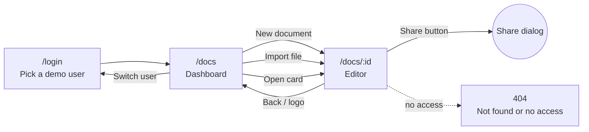
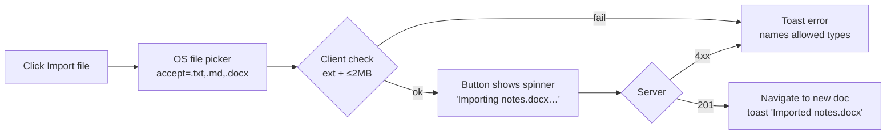

# UI/UX Specification

## 1. Design principles

1. **Writing first** — the editor canvas dominates; chrome is quiet and thin.
2. **Always know where you stand** — save status, your role, and who owns the doc are always visible.
3. **Ownership is obvious** — "My documents" vs "Shared with me" are separate sections with distinct badges.
4. **Fail loud, recover easy** — every error explains what happened and offers the next action.
5. **Familiar over novel** — Google-Docs-like patterns & shortcuts so reviewers need no instructions.

## 2. Information architecture & navigation



## 3. Visual system

| Token | Value | Use |
|---|---|---|
| Font | Inter (UI), system serif optional for doc body | |
| `--bg` | `#F8FAFC` (slate-50) | App background |
| `--surface` | `#FFFFFF` | Cards, editor page |
| `--border` | `#E2E8F0` (slate-200) | Dividers, cards |
| `--text` | `#0F172A` (slate-900) | Primary text |
| `--muted` | `#64748B` (slate-500) | Meta, timestamps |
| `--primary` | `#4F46E5` (indigo-600) | Primary buttons, focus ring |
| `--success` | `#16A34A` | "Saved" |
| `--warning` | `#D97706` | "Retrying…", view-only banner |
| `--danger` | `#DC2626` | Conflict, delete |
| Radius | 8px cards / 6px buttons | |
| Spacing | 4px grid (Tailwind default) | |
| Editor page | max-width 816px (≈ US Letter), padding 72px desktop / 20px mobile, white "paper" on grey bg | |

Role badges: **Owner** (indigo), **Editor** (green), **Viewer** (slate).

## 4. Screens

### 4.1 Login — `/login`

```
┌──────────────────────────────────────────────────────────┐
│                                                          │
│                    ▣ Ajaia Docs                          │
│          Lightweight docs for shared work                │
│                                                          │
│   ┌──────────────────────────────────────────────────┐   │
│   │  Sign in as a demo user                          │   │
│   │                                                  │   │
│   │  (A) Alice Owner     alice@ajaia.dev        →    │   │
│   │      Owns sample docs, shares them               │   │
│   │  (B) Bob Editor      bob@ajaia.dev          →    │   │
│   │      Can edit "Q4 Planning"                      │   │
│   │  (C) Carol Viewer    carol@ajaia.dev        →    │   │
│   │      Can view "Q4 Planning"                      │   │
│   └──────────────────────────────────────────────────┘   │
│   ⓘ Demo auth: no passwords. Tip: use a second browser  │
│     profile / incognito to be two users at once.         │
└──────────────────────────────────────────────────────────┘
```

- One click signs in. Hint tells reviewers how to test sharing side by side.

### 4.2 Dashboard — `/docs`

```
┌──────────────────────────────────────────────────────────────────┐
│ ▣ Ajaia Docs                                  (A) Alice Owner ▾  │
├──────────────────────────────────────────────────────────────────┤
│  [+ New document]   [⇪ Import file]  .txt .md .docx · max 2 MB   │
│                                                                  │
│  My documents (3)                                                │
│  ┌───────────────┐ ┌───────────────┐ ┌───────────────┐           │
│  │ ▤             │ │ ▤             │ │ ▤             │           │
│  │ Welcome to    │ │ Q4 Planning   │ │ Private notes │           │
│  │ Ajaia Docs    │ │ "Goals for…"  │ │ "Ideas…"      │           │
│  │ Edited 2m ago │ │ Edited 1h ago │ │ Edited 1d ago │           │
│  │ [Owner]   ⋮   │ │ [Owner] 👥2 ⋮ │ │ [Owner]   ⋮   │           │
│  └───────────────┘ └───────────────┘ └───────────────┘           │
│                                                                  │
│  Shared with me (1)                                              │
│  ┌───────────────┐                                               │
│  │ ▤             │                                               │
│  │ Bob's Ideas   │                                               │
│  │ from Bob Ed.  │                                               │
│  │ Edited 3h ago │                                               │
│  │ [Viewer]      │                                               │
│  └───────────────┘                                               │
└──────────────────────────────────────────────────────────────────┘
```

- Card: title (2-line clamp), 1-line preview, relative time, role badge, share count (owner only), kebab menu (Open, Share, Delete — owner only).
- Shared cards show **"from {owner name}"** — the visible owned/shared distinction.
- Grid: 4 cols ≥1280px, 3 ≥1024, 2 ≥640, 1 on mobile.

**Empty states**
- My documents: illustration + "No documents yet — create one or import a .txt, .md or .docx file." with both buttons.
- Shared with me: "Nothing shared with you yet. When someone shares a doc, it appears here."

**Loading**: 3 skeleton cards per section.

### 4.3 Editor — `/docs/:id`

```
┌──────────────────────────────────────────────────────────────────────┐
│ ← │ Q4 Planning✎                ✓ Saved · 10:42   [Owner]  [👥 Share] │
├──────────────────────────────────────────────────────────────────────┤
│ ↶ ↷ │ [Normal ▾] │ B  I  U │ • ≡  1. ≡                              │  sticky toolbar
├──────────────────────────────────────────────────────────────────────┤
│                                                                      │
│        ┌────────────────────────────────────────────────┐            │
│        │  Q4 Planning                (H1)               │            │
│        │                                                │            │
│        │  Goals                      (H2)               │            │
│        │  • Ship Ajaia Docs MVP                         │            │
│        │  • **Reduce** onboarding time                  │            │
│        │                                                │            │
│        │  1. Draft                                      │            │
│        │  2. Review                                     │            │
│        │  |                                             │            │
│        └────────────────────────────────────────────────┘            │
└──────────────────────────────────────────────────────────────────────┘
```

- **Title**: looks like text, becomes an input on click; Enter/blur saves; Esc cancels; empty → revert + toast "Title can't be empty".
- **Block-type dropdown**: Normal text / Heading 1 / Heading 2 / Heading 3.
- **Toolbar**: icon buttons with tooltips showing shortcuts; active state filled; `aria-pressed`.
- **Save status** (right of title):

| State | Display |
|---|---|
| Saved | `✓ Saved` (green, fades to muted after 2s) |
| Dirty/Saving | `⟳ Saving…` (muted) |
| Error | `⚠ Offline — retrying` (amber) |
| Conflict | `⛔ Out of date` (red) + banner |

**Viewer mode**
```
┌──────────────────────────────────────────────────────────────────────┐
│ ← │ Q4 Planning                                 [Viewer] from Alice  │
├──────────────────────────────────────────────────────────────────────┤
│ 👁  View only — ask Alice Owner for edit access.                      │  amber banner
└──────────────────────────────────────────────────────────────────────┘
```
Toolbar hidden, title not editable, no save status, no share button (or read-only list).

**Conflict banner**
```
⛔ This document was changed by someone else. Your latest edits weren't saved.
   [Copy my text]  [Reload latest]
```
"Copy my text" copies the local doc's plain text to clipboard so nothing is lost.

### 4.4 Share dialog

```
┌──────────────────────────────────────────────┐
│ Share "Q4 Planning"                       ✕  │
├──────────────────────────────────────────────┤
│ [ bob@ajaia.dev            ▾] [Editor ▾] [Share] │
│   suggestions: Bob Editor · Carol Viewer      │
│                                              │
│ People with access                           │
│ (A) Alice Owner  alice@ajaia.dev    Owner    │
│ (B) Bob Editor   bob@ajaia.dev    [Editor ▾] 🗑 │
│ (C) Carol Viewer carol@ajaia.dev  [Viewer ▾] 🗑 │
│                                              │
│ ⓘ Editors can edit and rename. Viewers can   │
│   only read. Only the owner can share.       │
└──────────────────────────────────────────────┘
```

- Email input with datalist autocomplete from `/api/users` (excludes self).
- Inline errors under input: "No user with that email", "You already own this document".
- Changing a role dropdown saves immediately (toast "Bob is now a Viewer").
- Remove → toast with no undo (simple), list updates optimistically, rolls back on error.
- Non-owners opening it see the list read-only.

### 4.5 Import flow



Also supports drag-and-drop of a file onto the dashboard (overlay "Drop to import") if time allows.

### 4.6 Delete

Confirm dialog: *"Delete 'Q4 Planning'? This removes it for everyone it's shared with. This can't be undone."* [Cancel] [Delete] (red).

### 4.7 Not found / no access

Centered: "Document not found — it may have been deleted, or you don't have access." [Back to documents]

## 5. Interaction details

| Shortcut | Action |
|---|---|
| ⌘/Ctrl + B / I / U | Bold / Italic / Underline |
| ⌘/Ctrl + Alt + 1/2/3 | Heading 1/2/3 |
| ⌘/Ctrl + Alt + 0 | Normal text |
| ⌘/Ctrl + Shift + 8 / 7 | Bullet / Numbered list |
| ⌘/Ctrl + Z / Shift+Z | Undo / Redo |
| ⌘/Ctrl + S | Force save now (prevent browser save dialog) |
| Markdown input rules | `# ` → H1, `- ` → bullet, `1. ` → numbered, `**x**` → bold |

Feedback & timing:
- Autosave debounce 1000ms; "Saved" confirmation within ~300ms after response.
- Toasts bottom-right, 4s, errors persist until dismissed.
- Optimistic UI for rename and share changes; rollback + toast on failure.

## 6. Accessibility checklist

- All icon buttons have `aria-label` + tooltip; toggle buttons expose `aria-pressed`.
- Toolbar is `role="toolbar"` with arrow-key roving focus (nice-to-have; Tab works at minimum).
- Editor region labelled `aria-label="Document body"`.
- Save status is an `aria-live="polite"` region.
- Dialogs trap focus, close on Esc, return focus to trigger.
- Contrast ≥ 4.5:1 for text; focus ring 2px indigo, never removed.
- Respect `prefers-reduced-motion` (no fades).

## 7. Responsive behavior

| Width | Behavior |
|---|---|
| ≥ 1024 | Full toolbar, paper layout with grey margins |
| 640–1023 | Paper fills width with 24px margins |
| < 640 | Toolbar scrolls horizontally; Share becomes icon-only; title truncates; cards 1-col |

## 8. Microcopy

| Moment | Copy |
|---|---|
| Placeholder | "Start writing…" |
| Import hint | "Supported: .txt, .md, .docx (max 2 MB). Imports become new documents." |
| Unsupported file | "Can't import 'report.pdf'. Supported types: .txt, .md, .docx." |
| Too large | "'big.docx' is 3.4 MB. Max size is 2 MB." |
| docx simplification | "Imported. Images and tables aren't supported and were skipped." (only when mammoth reports dropped content) |
| Share success | "Shared with Bob Editor as Editor" |
| Revoked/deleted while open | "You no longer have access to this document." |

## 9. Demo script alignment (for the walkthrough video)

1. Login as Alice → dashboard shows owned vs shared.
2. New doc → rename → type with H1, bold, bullets, numbered list → refresh → persists.
3. Import `sample.docx` → formatting preserved.
4. Share with Bob (Editor) and Carol (Viewer).
5. Incognito: Bob edits; Carol sees view-only.
6. Two tabs → trigger conflict banner.
7. Revoke Carol → her reload shows "no access".
